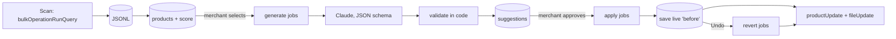

# Product Content Assistant (Shopify app)

Finds products with missing content, drafts descriptions, SEO fields and image alt text **from the data the product already has**, and writes to the store **only after the merchant approves**. Every change can be undone.

> Status: **v0 — first working build.** Builds, type-checks, unit tests pass. Not yet run against a development store, no Playwright run, no AI-quality benchmark yet. Designed against BFS criteria — not BFS certified.

## Screens

| Screen | What the merchant does |
|---|---|
| **Home** | Sees whether the app is working, catalog completeness, drafts waiting, products updated, background progress, AI spend today |
| **Products** | Sorted by completeness; select products (or "all incomplete") → queue drafts |
| **Review drafts** | Old vs new side by side, edit any field, see blocking problems next to the field, approve one or all clean drafts, discard |
| **History & undo** | Every saved change, one-click restore of the previous content |
| **Brand voice** | Voice, audience, language, banned words (Contextual Save Bar) |

## Architecture



- **Queue** (`app/lib/queue.server.ts`): jobs table in Postgres; retries with exponential backoff, longer waits on `THROTTLED`; jobs left `running` after a crash are re-queued. Progress is read from the table, so it stays correct after reloads.
- **No write without approval**: `apply` refuses a suggestion unless `status = approved` and `reviewedBy` is set. The edited draft is re-validated on the server before approval.
- **No invented specs** (`app/lib/validate.ts`): numbers/units in the output must exist in the product data; otherwise the draft is blocked until edited. Also length limits, allowed HTML only, banned words, and no sales/ranking promises (BFS 4.3.1).
- **Undo**: the *live* content is read from Shopify right before writing and stored in `product_versions`.
- **AI operations**: every call logged in `ai_calls` (prompt version, tokens, latency, error); per-shop daily cost cap; failures are shown, nothing is auto-filled.
- **Tenant isolation**: every table has `shop_id`; every query filters by the session's shop. Only product data is sent to the model.

GraphQL operations (bulk query, `node(id)` BulkOperation, `productUpdate`, `fileUpdate`, live content query) were validated against Admin API **2026-10** with the Shopify AI Toolkit. Scopes: `read_products, write_products, write_files` (`fileUpdate` needs `write_files`).

## Run it

```bash
nvm use 22
npm install
docker compose up -d           # Postgres
cp .env.example .env
npx prisma migrate deploy
shopify app dev                # links the app, opens the dev store
npm test
```

Leave `ANTHROPIC_API_KEY` empty for demo mode: drafts are built deterministically from title/type/vendor/tags and clearly say so.

## Acceptance criteria — status

| Criterion | Status |
|---|---|
| ≥95% of content on 50 sample products has no invented specs | Not measured yet (validator in place) |
| 1,000 products with correct progress through errors/reloads | Designed (durable queue), not load-tested |
| No write before approval | Enforced in `runApply`; needs an e2e test |
| Undo restores the exact previous content | Implemented; needs an e2e test on a dev store |
| No revenue/ranking promises in the UI | Copy reviewed + validator |
| Passes Agent Review (project 1) | Not run yet |

## Known gaps (v0)

- 2.9 translations (nice-to-have) not started.
- Worker runs in the web process; move to a separate process for production.
- Playwright flows need a dev store and are not written yet.
